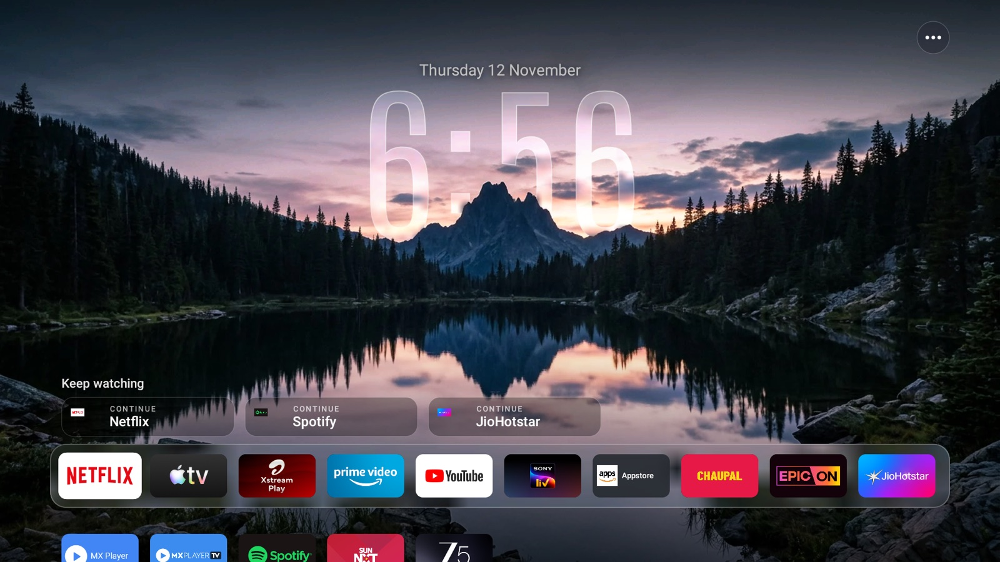
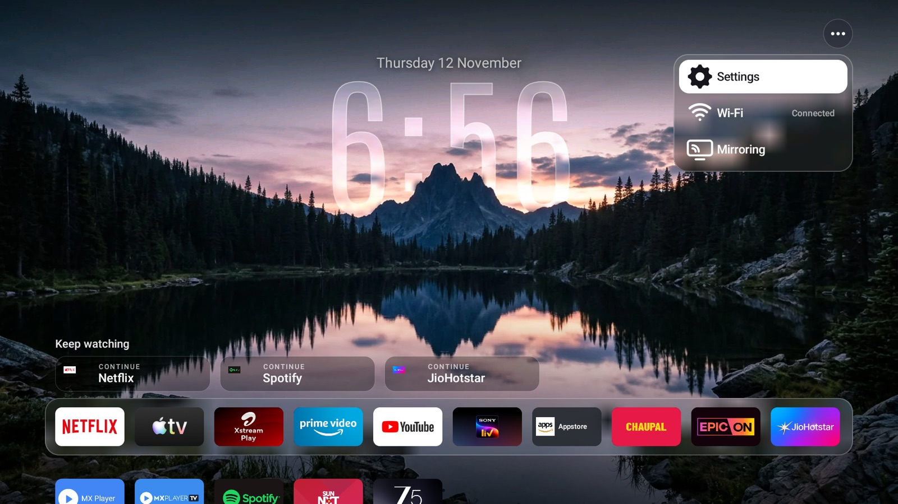
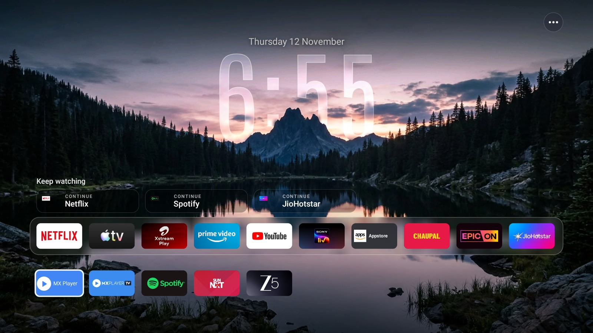

# Tv-Launcher

A custom home screen for **Amazon Fire TV**: no ads, no content rows, just a big glass clock, your apps
and a few shortcuts. It is built to feel instant, and it works around the fact that Fire OS will not
let you replace Amazon's launcher.

| Home | Menu |
|---|---|
|  |  |



## Features

- **Depth clock.** A tall, light, glass-style clock sits *behind* the scenery, so peaks and trees
  overlap the digits. The glass is the wallpaper itself, softly blurred, with a bright rim.
- **Bundled scenes.** Four scenes (night, golden hour, fog, dawn), each with a ready-made foreground
  cut-out, rotate every 3 hours. No network needed for wallpapers.
- **Compact app dock** in a frosted glass bar, with the rest of your apps in a grid below. Pin or
  unpin an app with the remote's **Menu** button (or a long press).
- **Keep watching.** Your most recently used apps as quick tiles. Fire OS does not share what you were
  watching, so these open the app, not the episode.
- **"..." menu** (top right) with **Settings**, **Wi-Fi** (shows connection state) and **Mirroring**.
  Mirroring opens Fire TV's own mirroring screen, the same one as long-press Home, then Mirroring.
- **Idle clock screen.** After 90 seconds without input on the home screen, the launcher fades to the
  scene with the big clock and date, drifting slowly to avoid burn-in. Any button brings the home
  screen back. (Fire OS runs Amazon's own screensaver and ignores third-party ones, so this is built
  into the launcher. A standard Daydream, `ClockDream`, is also included for devices that honour it.)
- **Clean app list.** System apps are hidden except a short allow-list, and you can hide any app by
  package name.
- **Overscan-safe layout** and D-pad-first focus handling.
- **Date** shown above the clock. The app makes no network requests of its own.

## How it works

Fire OS protects Amazon's own launcher: it can't be disabled or replaced, the Home key never reaches
third-party apps, and activity launches are delayed a few seconds after Home. So the app uses three
parts:

1. **`MainActivity`** is the real launcher (registered as a HOME activity). It hosts `HomeView`.
2. **`HomeRedirectService`** is an accessibility service that only listens for Amazon's home activity
   appearing. It immediately covers the screen with an overlay showing the last launcher frame, then a
   live copy of the launcher, and keeps nudging `MainActivity` to the front until it stays there. The
   overlay then fades away. It reads no screen content and no key presses.
3. **`HomeView`** is the whole UI as a single custom view, so the same code runs in the activity and
   in the overlay. **`HeroView`** draws the clock, the depth effect and the date. **`ClockDream`** is
   the screensaver.

When the launcher opens a system screen on purpose (Settings, Wi-Fi, Mirroring), it briefly pauses the
redirect so Amazon's screen isn't pulled back to the launcher.

## Requirements

- A Fire TV with ADB debugging on (Fire OS 7 / Android 9 tested on a Fire TV Stick).
- A computer with `adb` and, to build, JDK 17 and the Android SDK (no Android Studio needed).

## Install

Replace `<TV_IP>` with your Fire TV's IP address (Settings, My Fire TV, About, Network).

```bash
adb connect <TV_IP>:5555

# build (or use your own build of the APK)
export JAVA_HOME=/path/to/jdk17
./gradlew assembleDebug

adb -s <TV_IP>:5555 install -r app/build/outputs/apk/debug/app-debug.apk
```

### Turn on the Home redirect

The accessibility service must be enabled once. If you already use other accessibility services on the
TV, append this one to the existing list instead of replacing it.

```bash
adb -s <TV_IP>:5555 shell settings put secure enabled_accessibility_services \
  com.sahil.launcher/com.sahil.launcher.HomeRedirectService
adb -s <TV_IP>:5555 shell settings put secure accessibility_enabled 1
```

### Optional

```bash
# "Keep watching" from apps you used anywhere (usage access)
adb -s <TV_IP>:5555 shell appops set com.sahil.launcher GET_USAGE_STATS allow

# clock screensaver (Fire OS may ignore this setting on some versions)
adb -s <TV_IP>:5555 shell settings put secure screensaver_components com.sahil.launcher/.ClockDream
```

Press **Home** on the remote.

## Customise

Everything lives in `app/src/main/java/com/sahil/launcher/`.

| What | Where |
|---|---|
| Apps to hide | `HIDDEN` in `HomeView.java` |
| System apps to keep visible | `KEEP_SYSTEM` in `HomeView.java` |
| Scenes and their order | `SCENES` in `HomeView.java` and `app/src/main/assets/scenes/` |
| Scene rotation time | `ROTATE_MS` in `HomeView.java` |
| Clock size, position, glass | `HeroView.java` |
| Dock size and columns | `COLS`, `cardW()`, `cardH()` in `HomeView.java` |

To add your own scene, put `name.jpg` (1920x1080) and an optional `name-fg.webp` (the same image with
the sky made transparent) in `assets/scenes/` and add `name` to `SCENES`. Without a cut-out the clock
is drawn in front of the picture.

### Scenes

| Night | Golden hour |
|---|---|
|  |  |
| **Fog** | **Dawn** |
|  |  |

## Known limits

- Amazon's launcher can't be removed. On the first Home press after boot you may see its screen
  briefly; the overlay is designed to hide it.
- "Keep watching" opens apps, not episodes.
- The package name is `com.sahil.launcher`.
- Debug builds only; the APK is signed with the default debug key.

## License

MIT, see [LICENSE](LICENSE). The bundled scenes and font have their own terms, listed in
[NOTICE.md](NOTICE.md).

## Credits

- Scene images and foreground cut-outs from [couch-tv](https://github.com/Seagey/couch-tv) by Seagey
  (MIT). The look of this launcher is inspired by it.
- Clock font: Antonio, SIL Open Font Licence 1.1.

See [NOTICE.md](NOTICE.md).
